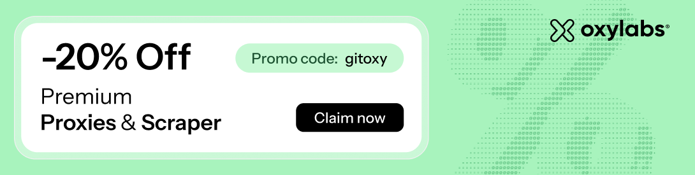

# 1688 Scraper API

[](https://oxylabs.io/pages/gitoxy?utm_source=877&utm_medium=affiliate&groupid=877&utm_content=1688-scraper-github&transaction_id=102f49063ab94276ae8f116d224b67)

<p align="left">
  <a href="https://dashboard.oxylabs.io"></a>
  <a href="https://developers.oxylabs.io/products/web-api"></a>
  <a href="https://dashboard.oxylabs.io"></a>
  <a href="https://discord.gg/Pds3gBmKMH"></a>
  <a href="https://www.youtube.com/@oxylabs"></a>
</p>

Oxylabs [1688 Scraper](https://oxylabs.io/products/scraper-api/ecommerce/1688?utm_source=github&utm_medium=repositories&utm_campaign=product) (part of Web Scraper API) is a real-time data gathering solution that uses a fast-adapting infrastructure for effortless 1668 product data extraction. It combines **automated proxy management, web data access, and parsing** to collect structured data from any public website at scale.

This brief guide showcases how the 1688 Scraper works, along with code examples to help you better understand how to use it hassle-free.

### How it works

You can get 1688 results by providing your own URLs to our service. We can return the HTML, parsed JSON, or Markdown output for any page you like.

#### Python code example

The example below illustrates how you can get HTML of 1688 page.

```python
import requests
from pprint import pprint

# Structure payload.
payload = {
    'source': 'universal',
    'url': 'https://fuzhuang.1688.com/nanzhuang?spm=a260k.dacugeneral.home2019category.2.663335e4bwa222'
}

# Get response.
response = requests.request(
    'POST',
    'https://realtime.oxylabs.io/v1/queries',
    auth=('user', 'pass1'),
    json=payload,
)

# Instead of response with job status and results url, this will return the
# JSON response with the result.
pprint(response.json())
```
Find code examples for other programming languages [**here**](https://github.com/oxylabs/1688-scraper/tree/main/code%20examples)

#### Output Example
```json
{
  "results": [
    {
      "content": "\r\n<!DOCTYPE html>\n<html>\n\n<head>\n  <link rel=\"dns-prefetch\" href=\"//polyfill.alicdn.com\">\n  <link re ... </html>",
      "created_at": "2025-02-20 12:15:04",
      "updated_at": "2025-02-20 12:15:08",
      "page": 1,
      "url": "https://fuzhuang.1688.com/nanzhuang?spm=a260k.dacugeneral.home2019category.2.663335e4bwa222",
      "job_id": "7165680254252520449",
      "status_code": 200
    }
  ]
}
```
Using our 1688 Scraper, you can easily harvest public data from any 1688 web page. Gather essential mobile phone data, such as price, reviews, or specific features, to monitor the market and outperform your competitors. If you require any assistance, connect with our support team through our live chat or email us at support@oxylabs.io.
